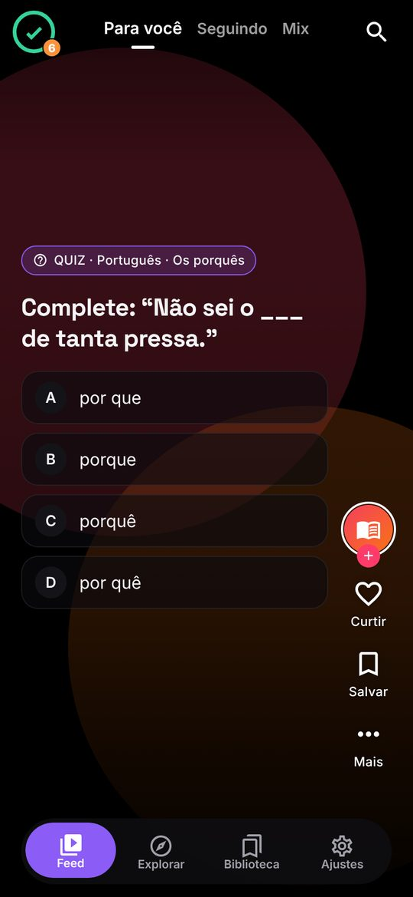
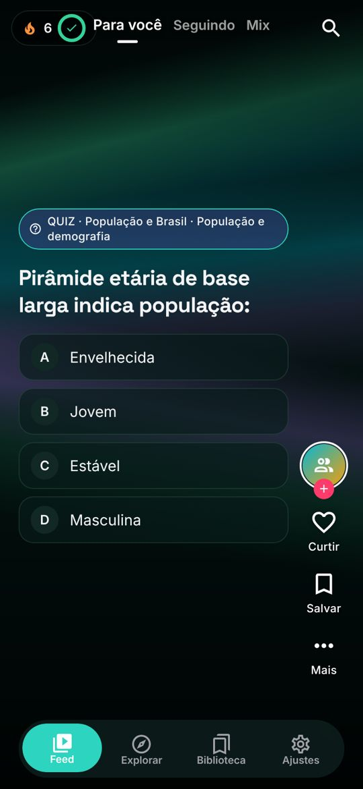
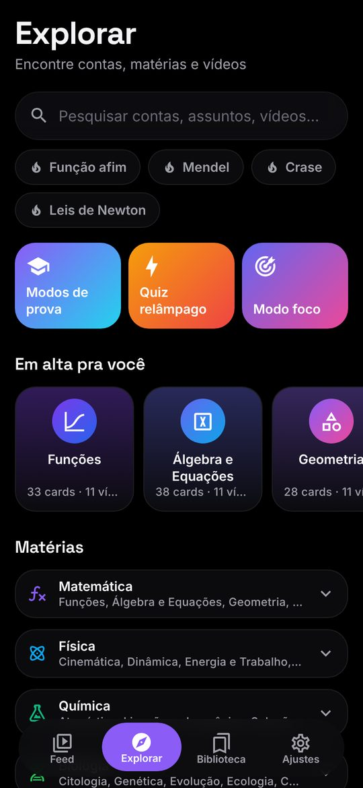
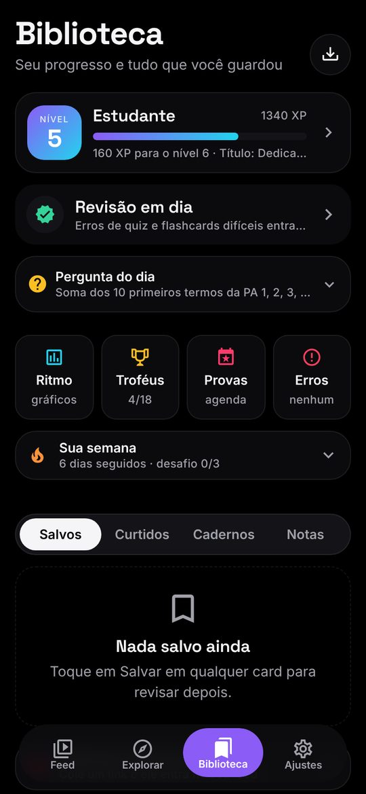
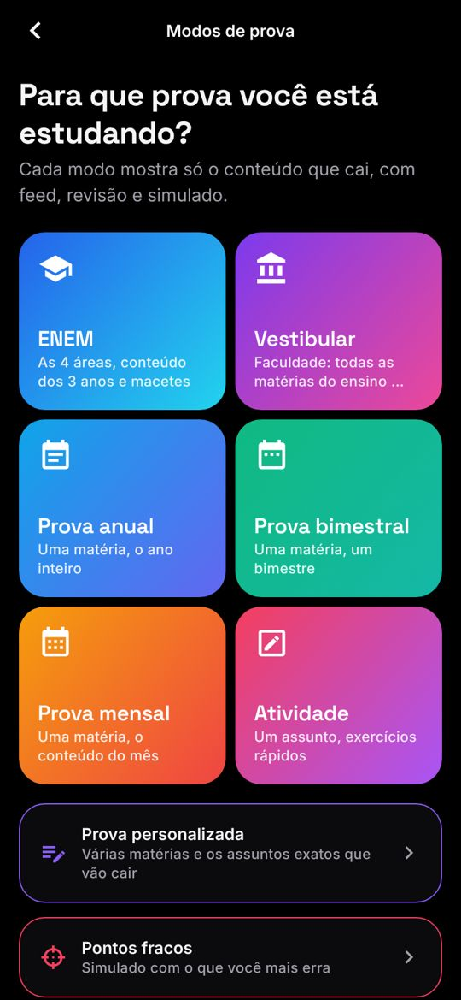
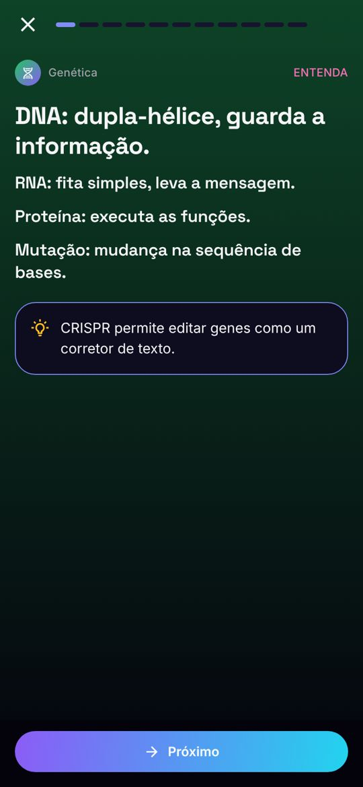
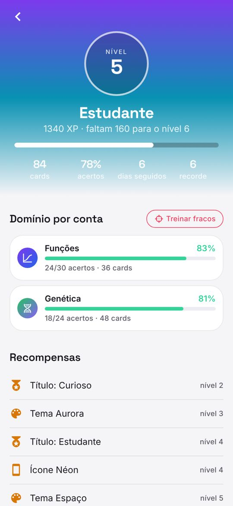
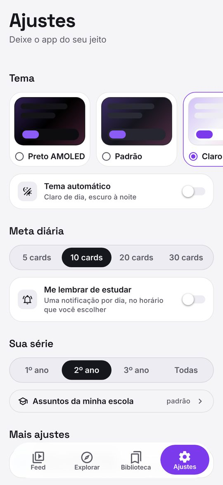

<div align="center">
  
  <h1>ScrollYourBrain</h1>
  <p><b>Estude no ritmo do scroll.</b> Um feed vertical, no estilo Reels/Shorts, feito só de conteúdo do ensino médio, ENEM e vestibular.</p>

  <a href="https://github.com/ZakWegues/ScrollYourBrain/releases/latest/download/ScrollYourBrain.apk"></a>
  <a href="https://github.com/ZakWegues/ScrollYourBrain/actions/workflows/android-apk.yml"></a>
  <a href="LICENSE"></a>
  
</div>

<p align="center">
  
  
  
  
</p>
<p align="center">
  
  
  
  
</p>

## Sumário
- [O que o app faz](#o-que-o-app-faz)
- [Instalar](#instalar)
- [Rodar e desenvolver](#rodar-e-desenvolver)
- [Como funciona por dentro](#como-funciona-por-dentro)
- [Conteúdo](#conteúdo)
- [Privacidade](#privacidade)
- [Contribuir](#contribuir)
- [Créditos e licença](#créditos-e-licença)

## O que o app faz

### Estudar no feed
- **Feed infinito em tela cheia**, card a card. Os formatos são:
  - conceitos animados;
  - quizzes;
  - flashcards;
  - **mais de 300 Shorts reais em português**, de todas as matérias, e trechos de aula, tocando dentro do app;
  - curiosidades da Wikipédia.
- **Para você · Seguindo · Mix:** o Mix junta as contas que você mais curtiu.
- **56 páginas**: 14 matérias e **42 contas de submatéria** (Funções, Cinemática, Genética, Redação…). Seguir uma matéria segue todas as contas dela.
- **O feed aprende com você:**
  - curtir e seguir aumentam um tema; pular rápido diminui;
  - a cada ~3 cards entra um vídeo (frequência ajustável);
  - **continua de onde você parou**.
- **Funciona offline** com o conteúdo embutido; vídeos e Wikipédia voltam quando a internet volta.

### Ensino médio e provas
- **Currículo** de 10 matérias × 3 séries × 4 bimestres, com **mais de 1.300 cards**. Há geradores de questões em 19 contas para o conteúdo nunca acabar.
- **Assuntos da minha escola:** você marca o que sua escola dá e o feed segue as marcas.
- **Modos de prova:** ENEM (por área), vestibular, prova anual, bimestral e mensal, e atividade.
  - Cada modo pode ser **personalizado** com várias matérias e os assuntos exatos.
  - Os modos personalizados podem ser salvos com nome.
- **Aula guiada** por assunto ou conta: conceito → flashcards → questões → vídeo.
- **Simulado dos pontos fracos**, montado com as contas em que você mais erra.
- **Caderno de erros:** toda questão errada fica guardada até você acertar.
- **Quiz relâmpago:** 60 segundos, com recorde.
- **Calendário de provas** e **reta final**, um plano de 7 dias para a próxima prova.
- **Macetes de prova**, a partir de reels de professores: ordem de prova pela TRI, chute por eliminação, gestão de tempo e macetes de exatas.

### Organizar e revisar
- **Revisão espaçada** (estilo SM-2) e **salvar vira revisão**.
- Cadernos, anotações em qualquer card e importação de matéria (texto, .txt ou .csv).
- Compartilhar um card como imagem.

### Motivação
- **XP, níveis e títulos.** Temas e ícones do app são desbloqueados por nível.
- Sequência e meta diária, **pergunta do dia**, desafio semanal e 18 conquistas.
- Estatísticas com resumo da semana e **domínio por conta**.

### Conforto
- **6 temas:** Preto AMOLED, Padrão, Claro, Aurora, Espaço e Oceano.
  - **Tema automático:** claro de dia, escuro à noite.
- Texto confortável (tamanhos e alto contraste), ouvir cards em voz alta e modo foco (Pomodoro).
- Widget de sequência e **atalhos no ícone** (Revisar, Quiz relâmpago, Modo foco) no Android.
- Lembrete diário e backup em arquivo.

## Instalar

**Android:** abra no celular o link abaixo e instale o APK. Ele sempre aponta para a versão mais nova.

> https://github.com/ZakWegues/ScrollYourBrain/releases/latest/download/ScrollYourBrain.apk

- Na primeira vez, o Android pede para permitir instalar apps "de fontes desconhecidas" pelo navegador.
- As próximas versões instalam por cima, sem perder seus dados.

O APK é gerado automaticamente pelo GitHub Actions a cada atualização (veja [docs/RELEASE.md](docs/RELEASE.md)).

## Rodar e desenvolver

Requisitos: **Node 22**, **JDK 17** e Android SDK, para builds nativos.

```bash
npm ci
npm start            # Metro + Expo (use um development build; o Expo Go não tem todos os módulos)
npm run android      # build nativo de desenvolvimento num celular/emulador
npm run web          # versão web (útil para testar layout)
```

| Script | O que faz |
|---|---|
| `npm run typecheck` | TypeScript estrito |
| `npm run lint` | ESLint (regras do Expo + React Compiler) |
| `npm test` | testes (Jest): motor do feed, currículo, contas, geradores, modos, XP, extras… |
| `npm run export:web` | gera a versão web em `dist/` |
| `npm run curate-videos` | atualiza a lista de vídeos (precisa do [yt-dlp](https://github.com/yt-dlp/yt-dlp)) |
| `npm run assets` | regenera ícones e splash a partir das fontes |

### Gerar o APK localmente

```bash
npx expo prebuild --platform android
cd android && ./gradlew assembleRelease
# APK em android/app/build/outputs/apk/release/app-release.apk
```

Para assinar com sua própria chave e gerar o AAB da Play Store, veja [docs/RELEASE.md](docs/RELEASE.md).

## Como funciona por dentro

**Stack:**
- Expo SDK 57, React Native 0.86 (nova arquitetura), expo-router e TypeScript;
- Reanimated 4, Gesture Handler e FlashList 2;
- zustand (com persistência local);
- [react-native-jelly-tabs](https://github.com/felipe-software/react-native-jelly-tabs) na barra de navegação.

```
app/                 telas (expo-router): abas, página de conta, modos, simulado, aula, revisão…
src/components/      feed, cards, folhas, fundo animado, componentes de UI
src/feed/            motor do feed, fontes (conteúdo, vídeos, Wikipédia, geradores), simulados
src/data/            páginas/contas, currículo do ensino médio, macetes
src/lib/             lógica pura e testada: XP, SRS, estatísticas, modos, pontos fracos, reta final…
src/store/           estado persistido (zustand)
src/theme/           temas, cores, tipografia
src/widget/          widget de sequência (Android)
scripts/             curadoria de vídeos e geração de assets
__tests__/           testes
```

Mais detalhes em [docs/ARCHITECTURE.md](docs/ARCHITECTURE.md).

## Conteúdo

- **Cards:** escritos à mão em `src/data/curriculum/` (uma DSL pequena e legível) e revisados quanto à precisão.
- **Questões geradas:** os geradores de `src/feed/sources/` criam questões com números novos, com resposta e explicação calculadas. Todos têm testes.
- **Vídeos:** canais brasileiros de professores, achados e filtrados por `scripts/curate-videos.mjs`.
  - Só entram vídeos em português que o YouTube permite incorporar; os que falham são pulados no app.
  - Os vídeos continuam pertencendo aos seus autores e são exibidos pelo player oficial do YouTube (IFrame API), dentro do app.

Como adicionar conteúdo: [docs/CONTENT.md](docs/CONTENT.md).

## Privacidade

Sem conta, sem anúncios e sem rastreamento. Tudo o que você faz fica **no seu aparelho**. Detalhes em [PRIVACY.md](PRIVACY.md).

## Contribuir

Ideias, correções de conteúdo e código são bem-vindos. Leia o [CONTRIBUTING.md](CONTRIBUTING.md) e o [código de conduta](CODE_OF_CONDUCT.md). Para falhas de segurança, veja o [SECURITY.md](SECURITY.md). O histórico de versões está no [CHANGELOG.md](CHANGELOG.md).

## Créditos e licença

- Barra de navegação: [**react-native-jelly-tabs**](https://github.com/felipe-software/react-native-jelly-tabs) (MIT), a mesma do Nuvio.
- Ícones: Material Design Icons. Fontes: Inter e Space Grotesk (OFL).
- Curiosidades: **Wikipédia** em português (CC BY-SA), com link para o verbete.
- Vídeos: **YouTube**, exibidos pelo player oficial; os direitos são dos canais.

Código sob a licença **MIT**. Veja [LICENSE](LICENSE).
