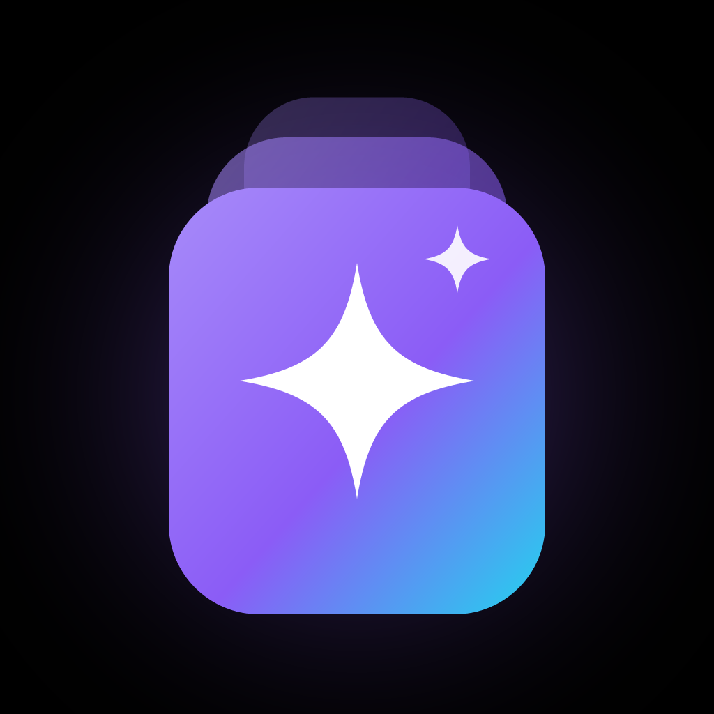

<div align="center">
  
  <h1>ScrollYourBrain</h1>
  <p><b>Estude no ritmo do scroll.</b> Um feed vertical, no estilo Reels/TikTok/Shorts, feito só de conteúdo educacional.</p>
  <p>Android · iOS · Web · Código aberto (MIT)</p>
</div>

## O que tem

**Estudar**
- **Feed infinito** em tela cheia, com snap card a card e cinco formatos:
  - conceitos animados (um "vídeo" feito por código);
  - quizzes;
  - flashcards;
  - vídeos do YouTube;
  - verbetes da Wikipédia.
- **O feed nunca fica vazio:** conteúdo embutido, geradores procedurais e fontes online. Funciona **offline**: sem internet aparece um aviso e o feed segue com o que roda sem rede.
- **O feed aprende com você:** curtir e seguir aumentam um tema; pular rápido diminui.
- **Revisão espaçada:** erros de quiz e flashcards marcados entram numa fila no estilo SM-2. A revisão diária mostra quando cada card volta.
- **Modos de prova:**
  - ENEM (por área), Vestibular;
  - prova anual, bimestral e mensal, e atividade, por matéria e série do ensino médio.
  - Cada modo junta o feed do conteúdo, a revisão, um simulado com tempo, o checklist de assuntos e a data no calendário.
- **Currículo do ensino médio:** 10 matérias × 3 séries × 4 bimestres, com mais de 450 cards e 350 questões.
- **Macetes de prova:** chute inteligente, gestão de tempo, revisão e pegadinhas.
- **Modo foco:** Pomodoro (15/25/50 min) com um feed só do tema escolhido.
- **Ouvir cards:** leitura em voz alta, sob demanda ou automática.

**Organizar**
- **Cadernos** para juntar cards por prova ou matéria.
- **Anotações** em qualquer card, que também aparecem na revisão.
- **Importar matéria:** colar texto ou abrir .txt/.csv (planilha, Anki) para gerar flashcards.
- **Calendário de provas:** contagem regressiva e meta sugerida de cards por dia.
- **Biblioteca:** salvos, curtidos, cadernos e notas.

**Motivação**
- **Sequência e meta diária**, com a pílula 🔥 no feed e uma comemoração ao bater a meta.
- **Desafio semanal** com três missões.
- **18 conquistas**.
- **Estatísticas:** tempo por dia e por tema, precisão e heatmap de 4 meses.
- **Lembrete diário** por notificação.
- **Widget Android** com a sequência e a meta do dia na tela inicial.

**Conforto**
- Tema **Preto AMOLED** ou **Padrão**.
- Texto Normal/Grande/Enorme e alto contraste.
- Reduzir movimento, vibração e economia de dados.
- **Backup** em arquivo para trocar de celular sem perder nada.
- **Onboarding** com escolha de temas e meta na primeira abertura.

A barra de navegação é a [react-native-jelly-tabs](https://github.com/felipe-software/react-native-jelly-tabs) (MIT), a mesma barra flutuante do [Nuvio](https://nuvio.tv). No Android ela é renderizada nativamente.

## Instalar no celular (Android)

1. No celular, abra este link: **https://github.com/ZakWegues/ScrollYourBrain/releases/latest/download/ScrollYourBrain.apk**
2. O download do `ScrollYourBrain.apk` começa sozinho. Toque em **Abrir** quando terminar.
3. Se o Android pedir, permita **instalar apps desta fonte** (o navegador) e toque em **Instalar**.
4. Para atualizar depois, é só abrir o mesmo link: a versão nova instala por cima e mantém seus dados.

O APK é para aparelhos arm64, o padrão dos celulares atuais. Cada build também fica em **Releases** no GitHub.

## Rodar localmente

Requisitos: Node 22. Para Android, também Android Studio e JDK 17.

```bash
npm install
npm run web        # navegador
npm run android    # build de desenvolvimento no Android (emulador ou aparelho)
npm run ios        # macOS + Xcode
```

> A barra jelly tem código nativo no Android, por isso o app usa um *development build* (`expo run:android`) e não o Expo Go.

## Scripts

| Comando | O que faz |
| --- | --- |
| `npm run typecheck` | Checagem de tipos (TypeScript) |
| `npm run lint` | ESLint |
| `npm test` | Testes do feed, geradores, sequência, provas, revisão, importação, estatísticas, desafios, calendário e backup |
| `npm run assets` | Regera ícone, splash e favicon a partir do SVG em `scripts/gen-assets.mjs` |

## Estrutura

```
app/                 rotas (expo-router): abas, página de tema e visualizador
src/feed/            motor de recomendação, fontes de conteúdo e hook do feed
src/components/      cards, item do feed, barra de ações e UI base
src/store/           estado persistido (zustand + AsyncStorage)
src/theme/           tokens de cor e tipografia (AMOLED e Padrão)
```

## Contribuindo

Para adicionar conteúdo, edite `src/feed/sources/seed.ts` (cards escritos à mão), `src/feed/sources/youtube.ts` (vídeos curados) ou crie um gerador em `src/feed/sources/generators.ts`. Rode `npm test` antes do PR.

## Licença

MIT. Veja [LICENSE](LICENSE).
